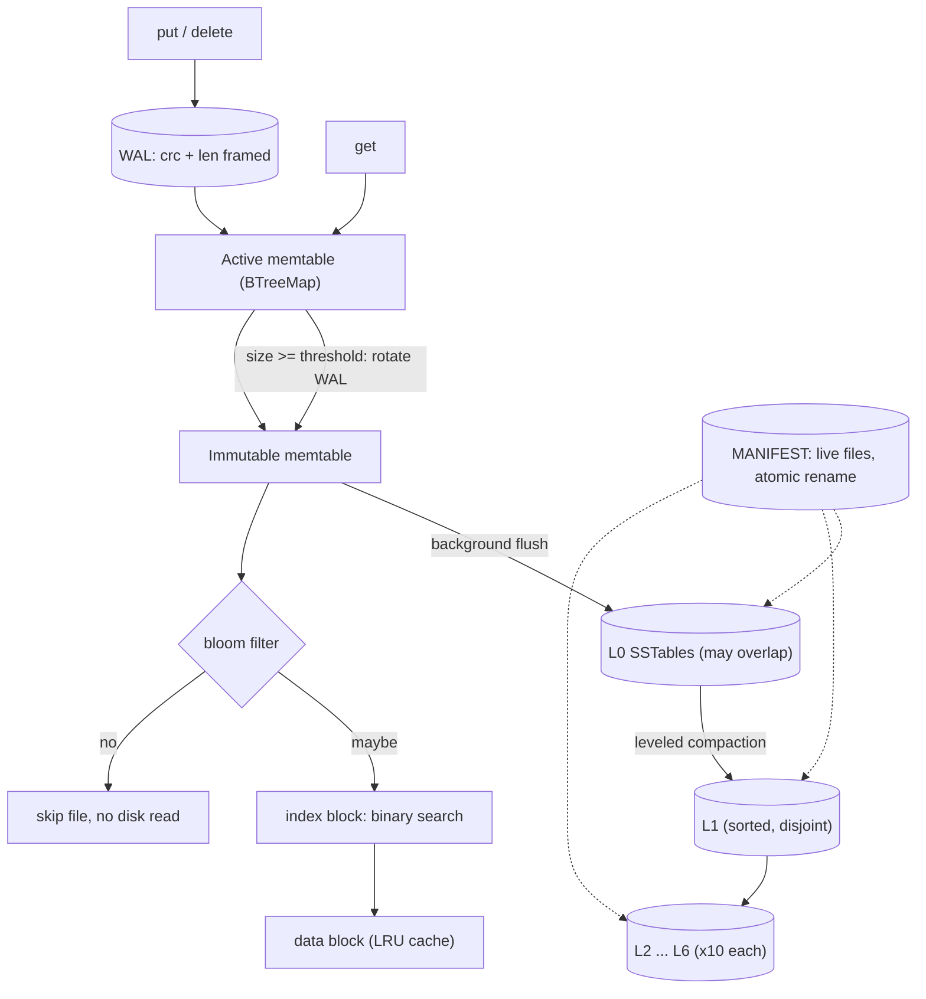

# lsm-tree-storage-engine

A LevelDB-style **LSM-tree key-value storage engine** in dependency-free Rust: write-ahead log, memtable, SSTables with prefix-compressed blocks and bloom filters, an atomic MANIFEST, leveled background compaction and an LRU block cache.

[](https://github.com/Alkarim786/lsm-tree-storage-engine/actions/workflows/ci.yml)


> Project 16 of Karim's 30 Days, 30 Projects series.

## Why this exists

Almost every modern write-heavy datastore (RocksDB, Cassandra, HBase, ScyllaDB, CockroachDB's Pebble) is built on a log-structured merge tree. B-trees update pages in place, which turns every small write into a random disk write. An LSM tree instead **buffers writes in memory, logs them sequentially, and merges sorted files in the background**, trading some read and space amplification for very cheap writes. This project builds that machinery from scratch, with every moving part (WAL framing, block format, bloom filter, manifest, compaction picker, merge iterator) written by hand and measured.

## Architecture



**Write path.** `put` takes the state lock, appends a CRC-framed record to the WAL (optionally `fsync`), inserts into the active memtable, and, once the memtable passes `memtable_size`, rotates: a new WAL is opened, the memtable becomes immutable and the background thread flushes it to an L0 SSTable. If the immutable memtable has not been flushed yet when the next one fills, writers **stall** (back-pressure); they also stall while L0 holds `l0_stop_writes` files.

**Read path.** `get` copies `Arc`s of the memtables and the current `Version` under the lock, then reads lock-free: active memtable, immutable memtable, L0 files newest-first, then at most one file per deeper level (found by binary search on key ranges). Each file consults its bloom filter before touching the index or any data block.

**Compaction.** Leveled, size ratio 10. L0 -> L1 fires at `l0_compaction_trigger` files and merges *all* L0 files plus the overlapping L1 files. For levels >= 1, when a level exceeds its size limit one file (round-robin by key) is merged with overlapping files in the next level. A `MergeIter` (binary heap over per-file iterators, newest source wins) streams the result into new files split at `target_file_size`, dropping shadowed versions and, when no deeper level overlaps the range, tombstones. The new `Version` is swapped in copy-on-write, the MANIFEST is rewritten atomically, and only then are input files marked obsolete; they are physically deleted when the last reader holding them is dropped.

**Recovery.** `open` loads the MANIFEST, deletes SSTables it does not list (leftovers of an interrupted compaction), replays every WAL with `id >= log_number` into a memtable (stopping at the first torn or corrupt record), flushes it to L0, and starts a fresh WAL.

### On-disk formats

```
WAL record : crc32(payload) u32 | len u32 | kind u8 | klen u32 | key | vlen u32 | value
SSTable    : [data block]* [index block] [bloom block] [footer 6 x u64: index_off, index_len,
              bloom_off, bloom_len, entry_count, MAGIC]
data block : (varint shared, varint unshared, varint value_len+1 (0 = tombstone), key delta, value)* + crc32
index block: (varint klen, last key of block, u64 offset, u32 len)* + crc32
MANIFEST   : text: next_id, log_number, "file <level> <id>" lines; written to MANIFEST.tmp, fsynced, renamed
```

## Tech stack

| Choice | Why |
|---|---|
| Rust, **zero crates** | Ownership makes the concurrency story (immutable `Arc<Version>` snapshots) checkable by the compiler; no dependencies means every algorithm (CRC32, bloom, LRU, heap merge, varints) is mine and reviewable. |
| `BTreeMap` memtable | Ordered, simple, and fast enough; a skip list would allow lock-free inserts (see Roadmap). |
| `Mutex` + `Condvar` state, one background thread | Easy to reason about; flush has priority over compaction so the immutable memtable never lingers. |
| Copy-on-write `Version` | Readers never block compaction and never see a half-applied change. |
| Text MANIFEST, rewritten whole | Few files, so a full rewrite + atomic rename is simpler and safer than an incremental edit log. |

## Features

- `put`, `get`, `delete`, `scan(start, end)`, `flush`, `compact_all`, `stats`
- WAL with CRC framing, configurable fsync, torn-tail tolerant replay
- Memtable freeze and background flush, write stalls (back-pressure)
- SSTables: prefix-compressed blocks, index block, bloom filter, per-block and index checksums
- Tombstones, shadowed-version GC, tombstone GC at the bottom level
- MANIFEST with atomic replace; orphan-file cleanup on open
- Leveled compaction with a heap-based merge iterator, round-robin file picking, output file splitting
- Byte-bounded LRU block cache (compaction reads bypass it so it is not polluted)
- Counters for write/space amplification, bloom effectiveness and cache hits
- `kv_cli` interactive shell and `bench` harness

## Roadmap (not built)

- MVCC snapshots with sequence numbers (currently each key keeps only its latest version; `scan` is not a point-in-time snapshot across concurrent writes)
- Size-tiered compaction for a direct comparison with leveled
- Block compression (snappy / lz4)
- Group commit for the WAL and a lock-free skip-list memtable
- Parallel compactions of disjoint key ranges, and partitioned L0 (sub-compactions)
- Restart points inside blocks (blocks are decoded sequentially today)

## Quick start

```bash
cargo run --release --example kv_cli -- ./data
```
```
> put hello world
> get hello
world
> scan a z
hello = world
> stats
```

Library use:

```rust
use lsm_engine::{Db, Options};

let db = Db::open("./data", Options::default())?;
db.put(b"user:1", b"alice")?;
db.delete(b"user:2")?;
assert_eq!(db.get(b"user:1")?, Some(b"alice".to_vec()));
for (k, v) in db.scan(b"user:", b"user;")? { /* ... */ }
db.flush()?;          // force memtable to disk
db.compact_all()?;    // full compaction down to the bottom level
println!("{:?}", db.stats().write_amplification());
```

Docker (image built and smoke-tested locally; CI also builds it on every push):

```bash
docker compose run --rm shell     # interactive shell, data in a named volume
docker compose run --rm bench     # benchmark table, N = 200k
```

### Local dev setup

Rust stable (rustup). On Windows with the GNU toolchain the linker breaks if your user profile path contains a space; use a space-free MinGW (`C:\tools\mingw64\bin` first on `PATH`) or the MSVC toolchain.

## API

| Method | Behaviour |
|---|---|
| `Db::open(dir, Options)` | create or recover a database |
| `put(k, v)` / `delete(k)` | durable once the WAL write returns (fsync only if `sync_writes`) |
| `get(k) -> Option<Vec<u8>>` | newest value, `None` if absent or deleted |
| `scan(lo, hi)` | live pairs with `lo <= k < hi`, sorted (materialised into a `Vec`) |
| `flush()` | freeze the memtable and wait until it is an SSTable |
| `compact_all()` | push everything to the bottom level, dropping garbage |
| `wait_for_compactions()` | block until background work is idle |
| `stats()` / `level_file_counts()` / `disk_bytes()` | introspection |

Key `Options`: `memtable_size` (4 MiB), `block_size` (4 KiB), `bloom_bits_per_key` (10; 0 disables), `l0_compaction_trigger` (4), `l0_stop_writes` (12), `level_base_size` (10 MiB), `size_ratio` (10), `target_file_size` (2 MiB), `block_cache_bytes` (8 MiB), `sync_writes` (false).

## Testing

```bash
cargo test --all-targets          # 22 tests
cargo clippy --all-targets -- -D warnings
cargo fmt --check
```

| Test | What it proves |
|---|---|
| CRC, varint, block round-trip, corruption detection | encodings are exact; a flipped bit is caught |
| Bloom: no false negatives, FP rate < 2% and < 2x theory | filter is correct and as tight as the maths says |
| WAL: truncate at **every** byte offset | replay always yields a clean prefix of the log |
| Merge iterator ordering / newest-wins / error propagation | compaction correctness core |
| SSTable build/read/iterate, obsolete-file deletion | file format round trip |
| Model-based test (12,000 random put/delete/get/scan ops vs `BTreeMap`, with 3 close/reopen cycles) | engine == reference model, including across recovery |
| Crash test (25 trials): truncate the newest WAL at a random byte | recovered state equals the model after *some prefix* of acknowledged writes |
| Compaction test | latest values survive, shadowed data is physically removed, tombstones vanish at the bottom, only live `.sst` files remain |
| Concurrency test (4 writers + 2 readers) | no torn or lost values under flush/compaction |
| Bloom integration test | missing-key lookups are skipped without block reads |

All tests ran locally on Windows; CI runs them on Ubuntu and Windows. There are no external services, so there is no separate "integration" environment to bring up.

## Benchmarks

Measured on: **AMD Ryzen 5 7520U (4 cores / 8 threads), 15.2 GB RAM, SK hynix BC901 NVMe SSD, Windows 11**. `cargo run --release --example bench -- 1000000`. 1,000,000 keys, 16-byte keys, 100-byte values, default `Options`, single thread issuing operations, one run (not averaged, so expect run-to-run noise). WAL `fsync` is **off** except where stated. Raw output: [docs/bench-results.md](docs/bench-results.md).

| Benchmark | Result |
|---|---|
| Sequential writes (fsync off) | 84,510 ops/s |
| Random writes (fsync off) | 63,918 ops/s |
| Sequential writes, **fsync on every write** (5,000 ops) | 1,012 ops/s |
| Write amplification, random overwrite (SSTable bytes / user bytes) | 3.56x (4.70x with WAL) |
| Space amplification after load | 1.05x |
| Flushes / compactions / write stalls | 31 / 42 / 11 |
| Random point reads, all hits | 12,551 ops/s (block cache hit ratio 7.2%) |
| Range scan, 1000-key ranges | 295,266 keys/s |
| Random misses, **with** bloom (10 bits/key) | 585,390 ops/s, 868 block reads for 100k probes |
| Random misses, **without** bloom | 13,197 ops/s, 99,394 block reads for 100k probes |
| Measured bloom false-positive rate | 0.88% (theory 0.82%) |
| Baseline: `BTreeMap` + append-only log, sequential writes | 97,881 ops/s |
| Baseline: in-memory `BTreeMap` random reads | 285,926 ops/s |

How to read this honestly:
- Bloom filters make absent-key lookups about **44x faster** and cut disk block reads by ~99%, and the measured false-positive rate matches theory.
- The "BTreeMap + log" baseline is faster for writes because it does no compaction and holds all data in RAM and has no read path from disk; it is a ceiling, not a competitor. The engine is within ~14% of it on sequential writes while staying bounded in memory and durable across restarts.
- `fsync` per write dominates: ~1k ops/s versus ~85k ops/s. That gap is why real systems use group commit (on the Roadmap).
- Point-read throughput (12.5k ops/s) is limited by uncached random block reads plus a decode of a whole 4 KiB block into owned `Vec`s per read; the 7% cache hit ratio reflects a 100 MB data set against an 8 MiB cache. Caching raw bytes and parsing entries lazily would be a clear next optimisation.
- Not compared against RocksDB/sled: I did not build those crates on this machine, so no such comparison is claimed.

## Key engineering decisions and trade-offs

- **Write vs read vs space amplification.** Leveled compaction keeps reads cheap (one file per level) at the cost of write amplification (3.56x here with ratio 10 and only 3 levels populated; it grows with depth). Size-tiered would invert this.
- **Durability knob.** `sync_writes` is the classic latency/durability trade-off; with it off, an OS crash can lose the tail of the WAL (a process crash cannot, since writes reach the OS before returning).
- **Torn-write safety.** Replay stops at the first record whose length or CRC is wrong, so a partially written final record is discarded and nothing acknowledged earlier is lost.
- **Atomic metadata.** The MANIFEST is replaced by rename; files are only deleted after the new MANIFEST is durable, and files not in the MANIFEST are garbage-collected on open, so a crash at any point leaves a consistent state.
- **Delete on Windows.** Windows cannot delete open files, so obsolete readers close their handle before unlinking in `Drop`.
- **Tombstone GC safety.** Tombstones are dropped only when no deeper level overlaps the compaction's key range, otherwise an older value would resurrect.
- **Known limitation.** One version per key: no snapshots; a long `scan` concurrent with writes may observe some newer writes. Flush and compaction are serialised on one thread.

## Project structure

```
src/
  lib.rs  db.rs  wal.rs  memtable.rs  merge.rs  manifest.rs  cache.rs  bloom.rs  crc.rs  stats.rs
  sstable/{mod,block,builder,reader}.rs
examples/{kv_cli,bench}.rs
tests/db_tests.rs
docs/bench-results.md
Dockerfile  docker-compose.yml  .github/workflows/ci.yml
```
